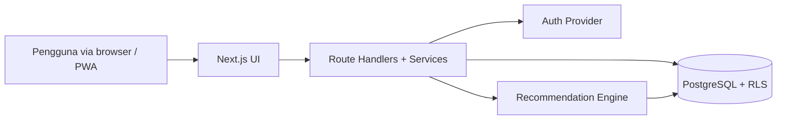
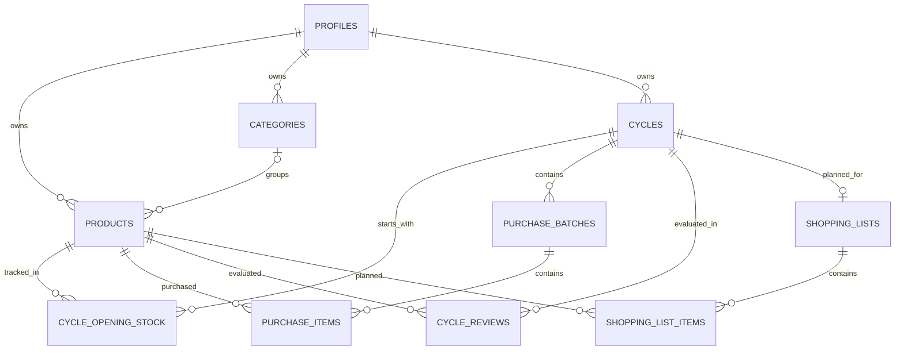
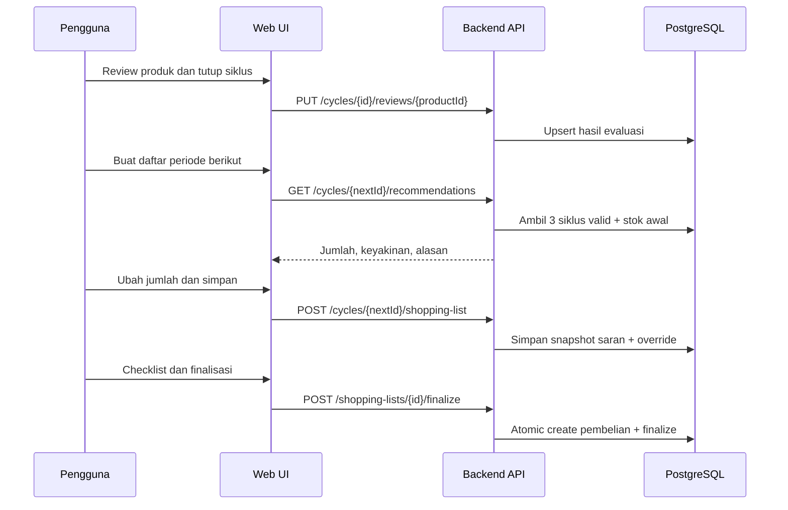

# SOFTWARE DESIGN DOCUMENT (SDD)
## StokBulanan — Desain Sistem Web App

**Versi:** 1.0 (draft teknis untuk MVP)  
**Tanggal:** 23 November 2026  
**Acuan:** PRD StokBulanan v1.0  
**Status:** Arsitektur usulan; bukan hasil implementasi

---

## 1. Sasaran desain dan keputusan arsitektur

Membangun aplikasi web mobile-first yang sederhana, aman untuk satu pengguna per akun, serta akurat **sebatas kualitas data yang diinput**. Poin desain terpenting ialah memisahkan **pembelian aktual**, **hasil evaluasi stok**, **rekomendasi terhitung**, dan **rencana belanja yang bisa diubah** agar histori tidak tercampur dengan prediksi.

### 1.1 Stack rekomendasi

| Lapisan | Teknologi | Alasan |
|---|---|---|
| Frontend | Next.js (App Router), React, TypeScript | Satu proyek full-stack; navigasi responsif |
| UI | Tailwind CSS + komponen aksesibel | Cepat dibuat, nyaman di perangkat mobile |
| Backend | Next.js Route Handlers + service layer TypeScript | Logika bisnis terpusat dan mudah diuji |
| Database | PostgreSQL (misalnya Supabase) | Relasi, transaksi ACID, constraint, RLS |
| Authentication | Supabase Auth, email magic link | Login sederhana dan pengelolaan sesi |
| Validasi | Zod | Validasi payload di sisi server, kontrak typed |
| ORM / query | Drizzle ORM atau SQL terparameterisasi | Query eksplisit dan migrasi terkontrol |
| Deployment | Vercel + database managed | MVP mudah deploy; opsi penyedia dapat diganti |
| Observability | Structured logs + error tracking | Melacak kegagalan tanpa mencatat data sensitif berlebihan |

Alternatif yang valid adalah monolit Django/Laravel + PostgreSQL. Stack di atas adalah **rekomendasi**, bukan ketergantungan produk.

### 1.2 Diagram konteks



Prinsip: browser tidak menerima service-role secret; seluruh operasi mutasi diverifikasi sebagai pemilik; rekomendasi dihitung di service layer, bukan oleh UI.

## 2. Modul

| Modul | Tanggung jawab utama | Entitas |
|---|---|---|
| Auth & Profile | Identitas, preferensi siklus, timezone | `profiles` |
| Product Catalog | Produk, kategori, ukuran kemasan aktif | `products`, `categories` |
| Shopping Cycle | Periode belanja, transisi status, sisa awal | `cycles`, `cycle_opening_stock` |
| Purchases | Catatan pembelian aktual dan harga | `purchase_batches`, `purchase_items` |
| Cycle Review | Evaluasi akhir dan hasil hitung fisik | `cycle_reviews` |
| Recommendation | Perkiraan jumlah, confidence, explanation | Hasil computed / `recommendation_snapshots` opsional |
| Shopping List | Rencana + override, ceklis, finalisasi | `shopping_lists`, `shopping_list_items` |
| Analytics | Riwayat dan kualitas rekomendasi | Query baca/agregasi |

## 3. Model data

### 3.1 Entitas dan kolom penting

**`profiles`** — `user_id uuid PK` (mengacu Auth), `timezone text default 'Asia/Jakarta'`, `default_cycle_days int default 30`, `safety_days int default 0`, `created_at`, `updated_at`.

**`categories`** — `id uuid PK`, `user_id uuid FK`, `name text`, `sort_order int`, `created_at`; unik `(user_id, lower(name))` via indeks ekspresi.

**`products`** — `id uuid PK`, `user_id uuid FK`, `category_id uuid nullable`, `name text`, `base_unit enum('pcs','g','ml')`, `pack_label text` (misal pouch/botol), `pack_size_base numeric(12,3)`, `purchase_increment_packs numeric(12,3) default 1`, `is_active bool`, `created_at`, `updated_at`; `pack_size_base > 0` dan `purchase_increment_packs > 0`.

**`cycles`** — `id uuid PK`, `user_id uuid FK`, `start_date date`, `end_date date`, `status enum('draft','active','closed')`, `closed_at`, `created_at`; `end_date >= start_date`; nonoverlap untuk satu pengguna pada status active/closed (constraint / transaksi locking).

**`cycle_opening_stock`** — `cycle_id uuid FK`, `product_id uuid FK`, `qty_base numeric(12,3)`, `source enum('carried','manual')`, `recorded_at`; PK `(cycle_id, product_id)`. Membekukan stok awal tiap siklus agar histori tidak berubah saat review sebelumnya dikoreksi.

**`purchase_batches`** — `id uuid PK`, `user_id uuid FK`, `cycle_id uuid FK`, `purchased_on date`, `source enum('manual','shopping_list')`, `shopping_list_id uuid nullable`, `created_at`; unique `shopping_list_id` jika tidak null untuk idempotensi finalisasi.

**`purchase_items`** — `id uuid PK`, `batch_id uuid FK`, `product_id uuid FK`, `qty_packs numeric(12,3)`, `pack_size_base_snapshot numeric(12,3)`, `qty_base numeric(12,3)` (dihitung server), `price_total_idr bigint nullable`, `created_at`; kuantitas >0, harga ≥0.

**`cycle_reviews`** — `id uuid PK`, `cycle_id uuid FK`, `product_id uuid FK`, `status enum('kurang','pas','cukup','berlebih')`, `remaining_qty_base numeric(12,3) nullable`, `stockout_date date nullable`, `reviewed_at`, `updated_at`, `note text nullable`; unique `(cycle_id,product_id)`; cek validasi status khusus pada server.

**`shopping_lists`** — `id uuid PK`, `user_id uuid FK`, `cycle_id uuid FK`, `status enum('draft','shopping','finalized')`, `generated_at`, `finalized_at`; satu daftar aktif per siklus untuk MVP.

**`shopping_list_items`** — `id uuid PK`, `shopping_list_id uuid FK`, `product_id uuid FK`, `suggested_qty_packs numeric(12,3)`, `planned_qty_packs numeric(12,3)`, `actual_qty_packs numeric(12,3) nullable`, `is_checked bool`, `confidence enum('tinggi','sedang','rendah')`, `reason_text text`, `last_price_per_pack_idr bigint nullable`; unique `(shopping_list_id,product_id)`.

**Opsional v1.1: `audit_events`** — pelacakan koreksi pembelian/review (actor, entity, old/new). Untuk MVP minimal simpan `updated_at`; log audit ideal sebelum pemakaian bersama.

### 3.2 Hubungan data



**Catatan desain penting:** `product_id` selalu diverifikasi milik `user_id` yang sama dengan siklus/batch. `qty_base` diturunkan di server dari kuantitas pack dan snapshot ukuran pack; jangan percaya nilai ini dari klien.

## 4. State dan alur transaksi

### 4.1 Siklus

`draft → active → closed`.

- `draft`: periode disusun; stok awal boleh diisi atau diimpor dari stok akhir valid periode sebelumnya.
- `active`: pembelian dan review dapat dicatat. Review bisa diisi bertahap.
- `closed`: snapshot akhir tersimpan, rekomendasi periode berikutnya boleh dihitung; koreksi eksplisit tetap tersedia dengan perhitungan ulang.

Validasi menutup siklus: tanggal valid, sisa tidak negatif, tidak ada produk review yang melanggar aturan status. Produk yang tidak di-review **tidak menghalangi** penutupan; diperlakukan sebagai data belum lengkap.

### 4.2 Finalisasi daftar belanja

Semua langkah berikut terjadi **dalam satu transaksi database**: kunci baris daftar → cek belum finalized → buat satu `purchase_batch` dari item `is_checked` (aktual jika ada, selain itu planned) → buat `purchase_items` → tandai finalized. Gunakan `shopping_list_id` unik dan transaksi untuk mencegah pembelian ganda saat request berulang.

### 4.3 Diagram urutan review ke daftar



## 5. Perhitungan rekomendasi

### 5.1 Definisi dan sumber data

- `N_next`: panjang siklus berikutnya dalam hari, inklusif.
- `buffer`: `profiles.safety_days`, default 0.
- `opening`: stok awal beku pada siklus historis.
- `purchased`: jumlah `qty_base` pembelian relevan di siklus historis.
- `remaining`: sisa hasil hitung fisik (`cycle_reviews.remaining_qty_base`).
- `days_observed`: jumlah hari stok tersedia; sampai tanggal habis untuk Kurang, atau panjang siklus jika tidak habis.
- `on_hand`: jumlah stok fisik paling mutakhir yang dikonfirmasi pengguna, disesuaikan pembelian setelah hitung; bila tidak ada hitung terbaru, gunakan `unknown`, bukan asumsikan nol.

**Perhatian:** total pembelian bukan selalu konsumsi. Sisa stok, pembelian susulan, dan barang rusak harus diperhitungkan. MVP mendukung pembelian susulan sebagai transaksi; bila data konsumsi menjadi ambigu, beri confidence rendah dan minta konfirmasi angka stok.

### 5.2 Data yang layak menjadi observasi

1. `Pas`: sisa 0; gunakan `opening + purchased` selama periode untuk estimasi pemakaian, bila konsisten.
2. `Cukup` / `Berlebih`: sisa >0 terisi; konsumsi = `opening + purchased − remaining`; periode observasi = panjang siklus.
3. `Kurang` dengan tanggal habis: jumlah yang tersedia **sampai tanggal habis** dibagi hari sampai habis (catatan: pembelian susulan setelah tanggal habis tidak masuk pembilang).
4. `Kurang` tanpa tanggal habis: jangan masukkan ke perhitungan daily rate; pakai fallback konservatif berlabel confidence rendah.
5. Data tidak konsisten (stok negatif, tanggal habis di luar siklus, pembelian ganda, stok awal tak diketahui): abaikan observasi dan minta koreksi.

### 5.3 Formula deterministik MVP

```text
observations = maksimal 3 siklus terbaru dengan data valid
rate_base_per_day = sum(consumed_base) / sum(days_observed)
target_qty_base = ceil_to_base_precision(rate_base_per_day * (N_next + buffer))
needed_base = max(0, target_qty_base - verified_on_hand_base)
recommended_packs = ceil(needed_base / pack_size_base / increment_packs)
                    * increment_packs
```

Pembulatan `ceil_to_base_precision` menggunakan 1 untuk `pcs`, 1 untuk `g`/`ml` jika kemasan praktis menyatakan bilangan utuh; aturan pembelian menggunakan kelipatan `purchase_increment_packs`. Jika `verified_on_hand` tidak diketahui, saran ditampilkan sebagai baseline yang memerlukan konfirmasi, bukan pengurangan stok dengan nol tersembunyi.

**Fallback tanpa rate valid:** rekomendasikan jumlah pembelian terakhir (atau jumlah awal yang diinput), lalu bila review terakhir = **Kurang tanpa tanggal**, tampilkan **opsi** menaikkan 1 kemasan (bukan klaim kebutuhan pasti). Confidence `rendah`; pengguna wajib dapat mengubah.

### 5.4 Confidence (aturan awal yang dapat diuji)

- **Tinggi**: ≥2 siklus valid, ada stok terverifikasi baru-baru ini, tidak ada konflik.
- **Sedang**: tepat 1 siklus valid dan stok tersisa terverifikasi.
- **Rendah**: fallback, stok tidak diketahui, tanggal habis kosong, atau histori ambigu.

Label confidence adalah indikator kualitas input, **bukan probabilitas statistik**.

### 5.5 Contoh uji perhitungan

| Produk | Historis (siklus 30 hari) | Sisa sekarang | Hasil untuk 30 hari, buffer 0 |
|---|---|---|---|
| Sabun | 2 pcs habis hari ke-20 | 0 | 3 pcs (2/20 × 30) |
| Pasta gigi | 2 pcs pas sampai hari ke-30 | 0 | 2 pcs |
| Deterjen | 4 pouch dibeli, 1 tersisa | 1 pouch | 2 pouch (target pemakaian 3, dikurangi 1) |
| Tisu | 5 pack dibeli, 2 tersisa | 2 pack | 1 pack (target pemakaian 3, dikurangi 2) |
| Pewangi | Tidak ada review | Tidak diketahui | Jumlah sebelumnya; label baseline/rendah |

## 6. API contract (REST v1)

Setiap endpoint mensyaratkan sesi pengguna; respons error konsisten: `{ "error": { "code": "...", "message": "..." } }`.

| Method | Endpoint | Input / output pokok |
|---|---|---|
| GET / POST | `/api/v1/products` | List / buat produk; search, category filter |
| GET / PATCH | `/api/v1/products/{id}` | Detail dan histori ringkas / edit atau arsip |
| GET / POST | `/api/v1/cycles` | Daftar / buat periode (`start_date`,`end_date`) |
| GET / PATCH | `/api/v1/cycles/{id}` | Status, progres, ubah draft |
| POST | `/api/v1/cycles/{id}/opening-stock` | Upsert stok awal per produk |
| POST | `/api/v1/cycles/{id}/purchases` | Buat batch manual + item pembelian |
| PUT | `/api/v1/cycles/{id}/reviews/{productId}` | Upsert status, sisa, tanggal habis |
| POST | `/api/v1/cycles/{id}/close` | Tutup siklus; cek invariants |
| GET | `/api/v1/cycles/{id}/recommendations` | Per produk: `suggested_packs`, `confidence`, `reason`, `inputs` |
| POST | `/api/v1/cycles/{id}/shopping-list` | Simpan snapshot rekomendasi dan perubahan |
| GET / PATCH | `/api/v1/shopping-lists/{id}` | Ambil daftar / ubah item dan status |
| POST | `/api/v1/shopping-lists/{id}/finalize` | Rekam pembelian aktual secara idempoten |
| GET | `/api/v1/products/{id}/history` | Histori belanja/review per produk |
| GET / PATCH | `/api/v1/settings` | Default hari, buffer, timezone |

### 6.1 Contoh response rekomendasi

```json
{
  "product_id": "uuid-produk-sabun",
  "unit": "pcs",
  "pack_size_base": 1,
  "next_cycle_days": 30,
  "verified_on_hand_base": 0,
  "suggested_packs": 3,
  "confidence": "sedang",
  "reason": "2 pcs habis dalam 20 hari; untuk 30 hari diperkirakan perlu 3 pcs.",
  "calculation_version": "rec-v1"
}
```

Contoh payload hanya ilustrasi; ID nyata berbentuk UUID. `confidence=sedang` sesuai 1 observasi valid.

### 6.2 Penanganan error

`400` validasi data; `401` belum login; `403` dilarang (atau `404` untuk tidak membocorkan eksistensi objek); `404` tidak ditemukan; `409` konflik siklus/finalisasi atau version conflict; `429` rate limit; `500` kegagalan internal. Gunakan server-generated idempotency key pada finalize atau constraint unik yang setara.

## 7. Antarmuka dan interaksi

### 7.1 Peta navigasi

```text
Dashboard
├── Produk (cari → detail/histori → edit)
├── Siklus (aktif → input pembelian → review → tutup)
├── Rekomendasi (lihat alasan → ubah jumlah)
├── Daftar belanja (checklist → finalisasi)
└── Pengaturan (durasi/buffer/akun)
```

### 7.2 Prinsip komponen UI

- `ProductCard`: nama, kategori, badge status terakhir, jumlah beli terakhir, tombol quick review.
- `ReviewForm`: empat pilihan status; input kondisional sisa/tanggal; validasi inline.
- `RecommendationRow`: jumlah dalam pack dan satuan dasar, alasan perhitungan, confidence, tombol +/-.
- `ShoppingItem`: checkbox besar, qty planned/actual terpisah, edit harga opsional.
- `CycleProgress`: jumlah produk yang sudah/belum dinilai; tombol tutup siklus.

UI menghindari pesan ambigu seperti “stok tersedia 2” jika baru berupa hitungan bulan lalu; gunakan “Terakhir tercatat sisa 2 pcs pada 30 Nov”.

## 8. Keamanan, privasi, konsistensi

- **Identity & access:** login via Supabase Auth; `user_id` dari sesi server, bukan request body. Aktifkan PostgreSQL RLS pada setiap tabel milik pengguna. Selain RLS, service memverifikasi kepemilikan relasi cross-table.
- **Session:** cookie aman `HttpOnly`, `Secure`, `SameSite` sesuai deployment; API mutasi terlindungi dengan strategi CSRF yang sesuai auth SDK.
- **Database:** foreign key, CHECK, indeks `(user_id, start_date)`, `(product_id, purchased_on via batch)`, unique `(cycle_id,product_id)` pada reviews.
- **Money:** IDR integer (`bigint`), bukan floating point; jumlah `numeric(12,3)` untuk menghindari error pembulatan.
- **Dates:** gunakan tanggal lokal untuk periode; timestamp UTC untuk audit; timezone dari profil.
- **Secrets:** service-role key hanya di server dan sebisa mungkin bukan pada request path reguler; jangan bocorkan melalui bundle frontend.
- **Deletion:** penghapusan akun/data harus dirancang eksplisit sebelum rilis umum; backup dan retention mengikuti kebijakan penyedia.
- **Logging:** catat trace ID/status/latensi, hindari mencatat email, token, dan isi belanja secara berlebihan.

## 9. Kinerja dan skalabilitas

Target MVP hingga 100 produk per akun dan histori multi-tahun. Query pembacaan rekomendasi mengambil maksimal 3 siklus valid per produk, dengan indeks di `cycle_reviews(cycle_id,product_id)` dan `purchase_items(product_id,batch_id)`. Data daftar belanja diambil dalam satu query teragregasi, bukan N+1. Untuk tahap ini, hitung rekomendasi on-demand; cache/snapshot hanya diperlukan jika performa terukur memburuk.

**Target operasional:** p95 query rekomendasi 100 produk <1 detik di server (target verifikasi), p95 endpoint baca umum <500 ms, error rate <1%, tidak ada pembelian ganda dari finalisasi berulang.

## 10. Strategi pengujian

### 10.1 Unit test

- Rumus stok: opening + purchased − remaining (dan penyesuaian bila diaktifkan).
- Days observed dengan tanggal habis dan panjang siklus inklusif.
- Pembulatan: 2,1 pack → 3 pack pada increment 1; 2,1 → 2,5 pada increment 0,5 jika diizinkan.
- Tidak ada data: baseline, confidence rendah, tidak divide-by-zero.
- Sisa lebih besar dari ketersediaan: error, bukan rate negatif.
- Tanggal habis di luar periode: error.
- Perubahan pack size tidak mengubah kuantitas transaksi historis.

### 10.2 Integration test

- RLS mencegah akun A mengakses produk/siklus milik B.
- Menutup siklus tidak menghapus review parsial.
- Perubahan review mengubah rekomendasi berikutnya setelah refresh; snapshot daftar yang sudah disimpan tidak otomatis berubah.
- Double-click finalize menghasilkan tepat satu `purchase_batch`.
- Transaksi gagal di tengah → tidak ada purchase item parsial.
- Produk lama berstatus inactive tetap terlihat dalam histori.

### 10.3 End-to-end test kritis

1. Daftar → buat 4 produk → input pembelian pertama → review akhir siklus.
2. Kurang dengan tanggal habis → rekomendasi naik dengan reason yang benar.
3. Berlebih dengan stok tersisa → rekomendasi berkurang / 0.
4. Generate daftar → override satu barang → checklist → finalize → histori benar.
5. Login akun lain → tidak ada kebocoran data dari akun pertama.
6. Uji pada viewport 360×800 dan desktop; navigasi keyboard dan label input.

## 11. Rencana implementasi teknis

| Tahap | Deliverable teknis | Exit criteria |
|---|---|---|
| A. Foundation | Repo, Auth, database, migrasi, RLS, CI | Auth + isolasi data lulus |
| B. Core CRUD | Produk, kategori, siklus, purchase batch | Data konsisten & dapat diuji |
| C. Review | Form status, validasi, closing snapshot | Semua aturan status lulus |
| D. Recommendation | Pure calculation module + explanatory output | Unit test sample dan edge case lulus |
| E. Shopping | Draft list, override, checklist, transactional finalize | No duplicate purchase |
| F. Release | Responsive QA, observability, backup, e2e | Siap pilot penggunaan pribadi |

## 12. Risiko dan mitigasi

| Risiko | Dampak | Mitigasi |
|---|---|---|
| Pengguna malas mengisi review | Saran tak akurat | Review satu layar, bisa batch, fallback jelas |
| Sisa stok tidak dihitung akurat | Rekomendasi bias | Tampilkan tanggal verifikasi, confidence rendah |
| Produk berubah ukuran kemasan | Histori salah | Snapshot ukuran pack saat pembelian |
| Siklus tumpang tindih | Perhitungan ambigu | Validasi tanggal + transaksi database |
| Pembelian susulan tidak dicatat | Angka stok salah | Penjelasan di UI; dukung transaksi susulan sejak MVP |
| Konversi satuan tidak konsisten | Jumlah salah | Base unit tetap per produk; validasi kuat |
| Klik ganda finalisasi | Histori terduplikasi | Idempotensi + constraint unik |

## 13. Asumsi, trade-off, dan roadmap

- **Trade-off utama:** menghindari tracking penggunaan harian berarti stok “real-time” tidak selalu diketahui. UI wajib jujur tentang ketidakpastian.
- **Satu akun per rumah untuk MVP:** meminimalkan kompleksitas sinkronisasi dan izin; tabel memakai `user_id` agar data privat.
- **Rumus transparan lebih dulu:** lebih mudah diuji daripada ML pada dataset kecil.
- **Pembelian susulan didukung, konsumsi harian opsional:** jika ada stokout lalu restock dalam satu siklus, hitung observasi berdasarkan rentang yang benar atau turunkan confidence.
- **Fase P1:** import CSV, harga/budget, email reminder, stok saat ini yang diperbarui manual, PWA offline terbatas.
- **Fase P2:** multiple household members, barcode/OCR, kategori konsumsi otomatis, prakiraan musiman.

## 14. Definition of Done (MVP)

MVP dianggap siap pilot bila semua fitur P0 berjalan dari login hingga histori belanja siklus kedua, seluruh contoh hitungan dan kasus tepi lulus tes, akses lintas pengguna ditolak, daftar finalisasi tidak menggandakan pembelian, dan antarmuka layak digunakan di ponsel. Keputusan beralih ke pengembangan berikutnya harus berdasarkan uji pengguna nyata, bukan asumsi akurasi model.

---

**Dokumen pendamping:** `PRD_StokBulanan_v1.md` — masalah pengguna, lingkup produk, alur, dan acceptance criteria.
